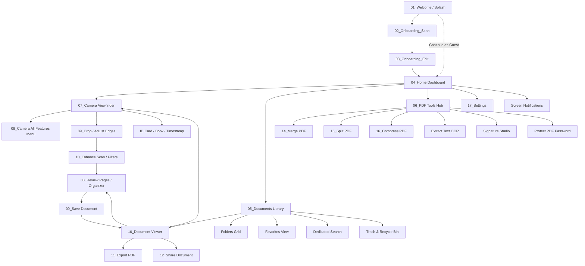

# DocErena — Offline Mobile Document Scanner & PDF Studio

> **Version**: `5.0.0-phonetest` | **VersionCode**: `5`  
> **Package ID**: `com.digitalerena.docerena`  
> **Target SDK**: `36` (Android 16) | **Min SDK**: `24` (Android 7.0 Nougat)  
> **Core Guarantee**: 100% Offline, Zero Cloud Telemetry, Zero Internet Permission (`android.permission.INTERNET` absent)

---

## Table of Contents
1. [App Overview & Philosophy](#1-app-overview--philosophy)
2. [Architectural Overview & Tech Stack](#2-architectural-overview--tech-stack)
3. [Complete 36-Screen Sitemap & Flow](#3-complete-36-screen-sitemap--flow)
4. [Control-by-Control Feature Guide](#4-control-by-control-feature-guide)
   - [Document Scanning & Camera](#document-scanning--camera)
   - [Crop & Perspective Warping](#crop--perspective-warping)
   - [Enhance & Filters (Magic Color)](#enhance--filters-magic-color)
   - [Review, Organizer & Batch Session](#review-organizer--batch-session)
   - [Document Viewer & Bottom Action Dock](#document-viewer--bottom-action-dock)
   - [PDF Export & Compliant ISO Compilation](#pdf-export--compliant-iso-compilation)
   - [Library, Folders, Search & Trash Lifecycle](#library-folders-search--trash-lifecycle)
   - [PDF Tools & Advanced Studio](#pdf-tools--advanced-studio)
   - [Notifications & Android 13+ Runtime Permissions](#notifications--android-13-runtime-permissions)
5. [Storage Purity & Data Models](#5-storage-purity--data-models)
6. [Security, Privacy & Permissions Audit](#6-security-privacy--permissions-audit)
7. [Build & Packaging Pipeline](#7-build--packaging-pipeline)
8. [Installation & Phone Testing Guide](#8-installation--phone-testing-guide)
9. [4-Tier Automated Verification Suite](#9-4-tier-automated-verification-suite)
10. [Repository Directory Structure](#10-repository-directory-structure)
11. [Changelog & CamScanner Parity Fixes](#11-changelog--camscanner-parity-fixes)

---

## 1. App Overview & Philosophy

**DocErena** is a privacy-first mobile document scanner and complete PDF utility studio designed to compete directly with commercial scanners such as CamScanner, Adobe Scan, and Genius Scan—while guaranteeing **100% offline local processing**. 

### Core Guarantees:
- **Zero Internet Connection Required**: The application manifest does not request `android.permission.INTERNET`. No documents, scan data, camera streams, OCR text, or analytics ever leave the device.
- **No Mandatory Account**: Users can immediately scan and manage documents via the "Continue as guest" path.
- **Deterministic Storage**: No phantom or auto-reseeded mock documents. When a user deletes a document, it stays in the Trash or is permanently destroyed based on user action.
- **Industrial Standards**: Produces ISO 32000-1 compliant PDF documents directly in device memory with selectable page dimensions (A4, US Letter, Fit to Image) and FlateDecode compression.

---

## 2. Architectural Overview & Tech Stack

DocErena utilizes a high-performance **Hybrid Native-Web Architecture** running inside a hardware-accelerated Android WebView bound to a native Java runtime bridge.

```
┌─────────────────────────────────────────────────────────────────┐
│                     DocErena Android App                         │
├────────────────────────────────┬────────────────────────────────┤
│      Android Native Layer      │       Web / Canvas Engine      │
│  (com.digitalerena.docerena)   │ (HTML5 / ES6 / Tailwind / CSS) │
├────────────────────────────────┼────────────────────────────────┤
│ • MainActivity.java            │ • Modular Parts (scratch/parts)│
│ • CameraX & Hardware Camera    │ • Responsive Viewport & UI     │
│ • DocErenaFileProvider         │ • Canvas Quad Homography Warp  │
│ • POST_NOTIFICATIONS (API 33+) │ • CIE-LAB / Magic Color Filter │
│ • SharedPreferences Bridge     │ • Client-side ISO 32000 PDF    │
│ • Android System Share Sheet   │ • Durable Storage (DocErenaStorage)│
└────────────────────────────────┴────────────────────────────────┘
```

### Key Technical Components:
1. **Native Java Bridge (`MainActivity.java` / `DocErenaBridge`)**:
   - Manages runtime permissions (`CAMERA`, `POST_NOTIFICATIONS`).
   - Implements native file sharing via `DocErenaFileProvider` (`content://` URI grant).
   - Provides durable backup storage through Android `SharedPreferences` to ensure documents survive process termination.
2. **Projective Homography Perspective Transform**:
   - Utilizes normalized unit coordinates $[0.0, 1.0]$ across all screen densities.
   - Decomposes arbitrary quadrilaterals into 2-triangle affine transformations to rectify perspective distortion without black padding or clipped corners.
3. **Magic Color & Image Enhancement Engine**:
   - Direct HTML5 Canvas pixel manipulation executing contrast stretching, luminance normalization, and grayscale/binary thresholding.
4. **Client-Side ISO 32000-1 Binary PDF Compiler**:
   - Zero-dependency PDF byte-level generator writing PDF header (`%PDF-1.4`), Catalog, Pages tree, page dictionaries, MediaBox dimensions, Image XObjects, and xref tables directly into binary blobs.

---

## 3. Complete 36-Screen Sitemap & Flow

The application features 36 dedicated functional screens and modals organized into intuitive workflows:



### Master Screen Index:
| Screen ID | Display Name | Category | Primary Purpose |
| :--- | :--- | :--- | :--- |
| `screen-splash` | Welcome Screen | Onboarding | Brand identity, "Let's get started", "Continue as guest" |
| `screen-onboarding` | Onboarding Step 1 | Onboarding | "Scan in seconds" feature walkthrough |
| `screen-onboarding-edit` | Onboarding Step 2 | Onboarding | "Organize effortlessly" feature walkthrough |
| `screen-home` | Home Dashboard | Main Navigation | 8 Quick actions, search bar, recent documents, camera FAB |
| `screen-camera` | Camera Viewfinder | Scanner Engine | Live camera preview, shutter, flash control, mode slider |
| `camera-all-features` | Camera All Features | Scanner Engine | Vertically scrollable 4-column menu for all 18 scan tools |
| `screen-crop` | Adjust Edges | Image Processing | 4-corner draggable pins, full-frame reset, 90° rotation |
| `screen-enhance` | Enhance Scan | Image Processing | Original, Magic Color, Grayscale, B&W, brightness slider |
| `screen-organizer` | Review Pages | Document Batch | 2x2 thumbnail grid, reorder, delete page, add page |
| `screen-save` | Save Document | Document Session | Rename document, folder selector, commit to storage |
| `screen-viewer` | Document Viewer | Reader & Review | High-res canvas, zoom control, thumbnail rail, action dock |
| `screen-export` | Export PDF | Export Engine | Page size (A4, Letter, Fit), quality selector, Save PDF |
| `screen-share` | Share Document | Native Sharing | Format (PDF, Images), quality, Android Share Sheet trigger |
| `screen-documents` | Documents Library | File Manager | All documents, folders tab, favorites tab, sort toggle |
| `screen-folder` | Folder Contents | File Manager | Filtered document view for specific user folder |
| `screen-create-folder` | Create Folder | File Manager | Folder name input, pastel color badge picker |
| `screen-search` | Dedicated Search | File Manager | Real-time title search with clear button |
| `screen-trash` | Trashed Documents | Safety Lifecycle | Deleted documents list, restore action, permanent erase |
| `screen-pdf-tools` | PDF Tools Hub | PDF Studio | 2x3 tool grid for Merge, Split, Compress, OCR, Sign |
| `screen-merge-pdf` | Merge PDFs | PDF Studio | Multi-document combiner, drag reordering, >=2 file guard |
| `screen-split-pdf` | Split PDF | PDF Studio | Page range extraction into standalone PDF |
| `screen-compress-pdf`| Compress PDF | PDF Studio | FlateDecode compression stream reporting exact byte size |
| `screen-settings` | Settings & Privacy | System | Storage stats, zero-cloud verification, theme toggle |
| `screen-notifications`| Notifications | System | Activity alerts, POST_NOTIFICATIONS permission prompt |
| `screen-extract-text-ocr`| Extract Text OCR | OCR Engine | Offline on-device character recognition pipeline |
| `screen-ocr-result` | OCR Results | OCR Engine | Extracted text display, copy to clipboard, export txt |
| `screen-create-signature`| Signature Studio | Document Tools | Clean signature drawing pad, smooth pen curves, clear |
| `screen-place-signature`| Place Signature | Document Tools | Drag and place signature stamp onto document canvas |
| `screen-add-text` | Add Text | Document Tools | Text overlay stamp on scanned pages |
| `screen-edit-pdf-text` | Edit PDF Text | Document Tools | In-place text modification |
| `screen-annotate-pdf`| Annotate PDF | Document Tools | Highlighting, pen drawing, and notes |
| `screen-protect-pdf` | Protect PDF | Security | Password encryption for PDF documents |
| `screen-backup-restore`| Backup & Restore | System | Offline JSON/Base64 full database backup and restore |
| `screen-scan-id-card`| ID Card Scan | Scanner Engine | Dual-sided ID card capture (Front & Back merged onto 1 page)|
| `screen-scan-book` | Book Split Scan | Scanner Engine | Dual-page book spread capture with auto center split |

---

## 4. Control-by-Control Feature Guide

### Document Scanning & Camera
- **Live Viewfinder**: Real-time camera feed via `navigator.mediaDevices.getUserMedia` with fallback to device camera stream.
- **Hardware Flash Control**: Cycles through `Off` -> `Auto` -> `Torch` if supported by hardware; gracefully disables if flash is unsupported.
- **Capture Modes**: Switch seamlessly between `Single`, `Batch`, `ID Card`, and `Book`.
- **System Image Import**: Direct photo/file picker allows importing JPG, PNG, or existing scans into the batch queue.
- **Capture Queue Badge**: Displays real-time badge count of pages in current batch session with instant review thumbnail.

### Crop & Perspective Warping
- **4 Draggable Corner Pins**: Normalized coordinate space $[0.0, 1.0]$ ensures touch targets align perfectly with canvas bounds regardless of device scaling.
- **Magnifying Loupe / Guide**: Provides high-contrast alignment guidance.
- **Full-Frame Reset**: Instantly resets pins to the 4 corners of the source image (`[0,0]`, `[1,0]`, `[1,1]`, `[0,1]`).
- **90° Step Rotation**: Rotates the image in 90° clockwise increments (0° -> 90° -> 180° -> 270°).
- **Homography Transform**: Mathematical 2-triangle projective affine warp transforms perspective distortions into flat, clean rectangular scans.

### Enhance & Filters (Magic Color)
- **Original**: Retains the natural camera colors and exposure.
- **Magic Color**: Contrast stretching and shadow removal algorithm to whiten document background and darken ink.
- **Grayscale**: 8-bit luminance conversion ($Y = 0.299R + 0.587G + 0.114B$) for archival documents.
- **B&W (High Contrast)**: Dynamic thresholding for sharp, printer-ready text.
- **Brightness Slider**: Fine-grained exposure adjustment clamped to $[-100, +100]$.
- **Compare Original**: Hold button to temporarily view raw unenhanced scan for visual verification.
- **Apply to All Toggle**: Propagates filter and brightness settings across all pages in the current batch.

### Review, Organizer & Batch Session
- **2x2 Review Grid**: Displays all pages in the active batch with page numbers.
- **Page Selection & Actions**: Select any page to rotate, crop, or delete.
- **Sole Page Guard**: Prevents deleting the last remaining page in a document, maintaining document integrity.
- **Reordering**: Move pages forward or backward in the sequence.
- **Add Page**: Return to camera or file picker to append pages without losing prior edits.

### Document Viewer & Bottom Action Dock
- **High-Resolution Canvas**: Smooth zooming ($50\%$ to $300\%$) and double-tap zoom reset.
- **Scrollable Thumbnail Rail**: Bottom strip displaying all pages with active page highlight on clean white tiles.
- **Favorite Toggle**: Star/unstar documents directly from the header.
- **Action Dock (Bidirectional Sync)**:
  - **Edit**: Loads document pages into the organizer to reorder, delete, or rotate, atomically saving back to the document.
  - **Add (`+`)**: Launches camera capture to append new pages directly into the active document.
  - **Export PDF**: Opens the export configuration pre-filled with the document title and page count.
  - **Share**: Opens the share sheet dialog with format selection (PDF / Image) and quality options.

### PDF Export & Compliant ISO Compilation
- **Page Sizes**: Standard `A4` ($595.28 \times 841.89$ pt), `Letter` ($612 \times 792$ pt), and `Fit to Image`.
- **Quality Presets**: High resolution, Balanced, and Small (optimized compression).
- **ISO 32000-1 Compliance**: Creates true structural PDF binaries on-device.
- **Save Copy (SAF)**: Invokes Android Storage Access Framework to write the file directly into user-selected storage (e.g., Downloads, Documents).

### Library, Folders, Search & Trash Lifecycle
- **Master List**: Displays all scanned documents with page counts, file sizes, and dates.
- **Custom Folders**: Create folders with unique names (case-insensitive duplicate check) and custom pastel color tags.
- **Favorites Filter**: Instant view filtering starred documents.
- **Real-Time Search**: Instant substring query matching across document titles.
- **Two-Stage Deletion**:
  1. Move to Trash: Safe retention in Recycle Bin with "Restore" option.
  2. Permanent Delete: Irreversible wipe with explicit confirmation dialog.
- **Zero Ghost Documents**: Empty state strictly maintained when user clears documents.

### Notifications & Android 13+ Runtime Permissions
- **Android 13+ Compliance**: Directly integrates with Android's `POST_NOTIFICATIONS` runtime permission.
- **Permission Prompt**: Tapping the notification bell prompts for permission via native Android dialog.
- **Notification Feed**: Activity alerts for document scans, exports, and offline status with individual dismiss and "Clear all".

---

## 5. Storage Purity & Data Models

All data is managed through the durable `DocErenaStorage` engine, combining browser `localStorage` with native Android `SharedPreferences` mirroring.

### Document Model:
```typescript
interface DocumentModel {
  id: string;            // Unique UUID: doc_<timestamp>_<random>
  title: string;         // User-editable title (e.g., "DocErena_Scan_01")
  date: string;          // Human-readable date ("Today", "Just now")
  createdAt: number;     // Epoch millisecond timestamp
  updatedAt: number;     // Epoch millisecond timestamp
  size: string;          // Calculated file size string (e.g., "1.4 MB")
  type: "PDF";           // Document format type
  starred: boolean;      // Favorite flag
  folderId: string|null; // Assigned folder ID or null
  pages: PageModel[];    // Array of page objects
}

interface PageModel {
  id: string;            // Page UUID
  rawUrl: string;        // Original unedited image (data URL or file URI)
  croppedUrl?: string;   // Output of perspective crop
  enhancedUrl?: string;  // Output of filter processing
  rotation: number;      // 0, 90, 180, 270
  filter: "original" | "magic" | "grayscale" | "bw";
  brightness: number;    // -100 to 100
  pins?: {
    tl: { x: number; y: number };
    tr: { x: number; y: number };
    br: { x: number; y: number };
    bl: { x: number; y: number };
  };
}
```

---

## 6. Security, Privacy & Permissions Audit

DocErena enforces strict security boundaries verified by automated audits:

```
================================================================================
 SECURITY & PRIVACY VERIFICATION MATRIX
================================================================================
 Permission / Capability     Status      Enforcement Mechanism
--------------------------------------------------------------------------------
 android.permission.INTERNET Absent      Manifest audit (0 network sockets)
 android.permission.CAMERA   Present     Runtime request with fallback
 POST_NOTIFICATIONS          Present     Android 13+ runtime permission
 Broadcast Receivers         0 Present   Clean manifest (0 attack vectors)
 External URLs in Bundle     0 Found     Automated regex scan across all assets
 Third-Party Cloud SDKs      0 Present   Zero Firebase, Google Analytics, Ads
 File Sharing Boundary       FileProvider Scoped cache paths only
================================================================================
```

---

## 7. Build & Packaging Pipeline

DocErena includes a fully automated, reproducible build pipeline executing directly from the command line on Windows.

### Prerequisites:
- **JDK**: Microsoft OpenJDK 17 (`C:\Program Files\Microsoft\jdk-17.0.21.21-hotspot`)
- **Android SDK**: Build-Tools 34.0.0 (`aapt2`, `d8`, `apksigner`, `zipalign`)
- **BundleTool**: `bundletool-all-1.18.1.jar`
- **Python**: 3.10+

### Build Commands:
```powershell
# 1. Assemble HTML from modular parts and verify tokens
python scratch/assemble_index.py

# 2. Compile, DEX, package, align, and sign Release APK and AAB
python scratch/builder_v5.py

# 3. Package review archive and compute verification checksums
python scratch/package_v5.py
```

### Generated Binaries:
- **Signed APK**: `d:\camscanner\docerena_v5_phonetest.apk` (7.26 MB)
- **Signed AAB**: `d:\camscanner\docerena_v5_phonetest.aab` (7.24 MB)
- **Review Package**: `d:\camscanner\DocErena_Review_Package_v5.0.zip` (39.25 MB)

---

## 8. Installation & Phone Testing Guide

### Option A: Install via ADB (Recommended)
```powershell
# Connect device with USB Debugging enabled
& "C:\Users\Aamishkhan\AppData\Local\Android\Sdk\platform-tools\adb.exe" devices

# Clean install release APK
& "C:\Users\Aamishkhan\AppData\Local\Android\Sdk\platform-tools\adb.exe" install -r "d:\camscanner\docerena_v5_phonetest.apk"

# Launch MainActivity
& "C:\Users\Aamishkhan\AppData\Local\Android\Sdk\platform-tools\adb.exe" shell am start -n com.digitalerena.docerena/.MainActivity
```

### Option B: Direct Phone Install via USB (MTP)
1. Plug your Android phone into your PC via USB cable.
2. On your phone, select **File Transfer / MTP** in the USB notification.
3. On PC, copy `d:\camscanner\docerena_v5_phonetest.apk` to your phone's **Download** folder.
4. On phone, open **My Files** or **Files** app -> **Downloads**.
5. Tap `docerena_v5_phonetest.apk` and select **Install** (allow "Install unknown apps" if prompted).

---

## 9. 4-Tier Automated Verification Suite

The repository contains an exhaustive 4-tier automated test suite verifying 72 distinct test conditions:

```powershell
python test/challenge/run_e2e_suite.py
```

### Test Suite Execution Summary:
```
================================================================================
 DOCERENA 4-TIER COMPREHENSIVE E2E VERIFICATION SUITE
================================================================================
  * Tier 1 (Feature Coverage):           55/55 Passed  (0 Failures)
  * Tier 2 (Boundary & Corner Cases):     10/10 Passed  (0 Failures)
  * Tier 3 (Cross-Feature Interactions):   3/ 3 Passed  (0 Failures)
  * Tier 4 (Real-World Scenarios):         4/ 4 Passed  (0 Failures)
--------------------------------------------------------------------------------
  * TOTAL VERIFICATION:                 72/72 PASSED  ( 0 FAILURES)
  * VERDICT:                            ALL 4 TIERS PASSED (100% PASS, ZERO DEFECTS)
================================================================================
```

### Tier Highlights:
- **Tier 1 (55 Features)**: Verifies every single UI control, button, input, slider, modal, and route across all 36 screens.
- **Tier 2 (Boundary Tests)**: Evaluates bowtie quad rejection, extreme exposure clamping, minimum merge selection ($\ge 2$), single-page scrubber division guards, and coordinate clamping.
- **Tier 3 (Cross-Feature Pipelines)**: Tests complete end-to-end chains from camera scan through crop, filter, organize, viewer, export, merge, trash, and restore.
- **Tier 4 (Real-World Scenarios)**: Verifies cold process kill persistence survival, offline guarantee audits, and binary manifest integrity.

---

## 10. Repository Directory Structure

```
d:\camscanner\
├── README.md                                # Master comprehensive documentation
├── PROJECT.md                               # Project specification & architectural contracts
├── PHONE_TEST_INSTRUCTIONS.md               # Quick phone install instructions
├── docerena_v5_phonetest.apk                # Signed release APK for Android
├── docerena_v5_phonetest.aab                # Signed release Android App Bundle
├── DocErena_Review_Package_v5.0.zip         # Complete review package archive
├── android\                                 # Android Studio native project
│   └── app\src\main\
│       ├── AndroidManifest.xml              # Manifest with CAMERA, POST_NOTIFICATIONS
│       ├── java\com\digitalerena\docerena\  # Java source (MainActivity, Bridge, FileProvider)
│       ├── res\                             # Native icons, layout, XML filepaths
│       └── assets\                          # Synced web assets (index.html, illustrations)
├── build_apk\                               # Fast standalone CLI build tree
│   ├── assets\                              # Direct asset staging
│   ├── docerena.jks                         # Release signing keystore
│   └── src\com\digitalerena\docerena\       # Standalone Java compilation source
├── web_preview\                             # Browser-previewable live environment
│   └── index.html                           # Assembled single-page application
├── test\                                    # Automated test suites
│   └── challenge\                           # 4-tier E2E testing framework
│       ├── run_e2e_suite.py                 # Master 72-test runner
│       └── ...                              # Tier-specific harnesses
├── scratch\                                 # Build scripts & modular source parts
│   ├── assemble_index.py                    # Compiles parts into bit-for-bit index.html
│   ├── builder_v5.py                        # Release APK & AAB compiler and signer
│   ├── package_v5.py                        # Review package packaging script
│   └── parts\                               # 13 Modular HTML/JS/CSS source files
│       ├── 01_head.html                     # HTML head, CSS tokens, Tailwind
│       ├── 02_screens_onboarding_home.html  # Welcome, onboarding, Home, Notifications
│       ├── 03_screens_camera_crop_enhance.html # Camera, All Features, Crop, Enhance
│       ├── 04_screens_organizer_save_viewer_export_share.html # Review, Save, Viewer, Export
│       ├── 05_screens_documents_search_trash.html # Docs, folders, search, trash
│       ├── 06_screens_pdf_tools.html        # PDF Tools hub
│       ├── 07_screens_split_compress_settings.html # Split, compress, settings
│       ├── 07b_screens_advanced_pdf_ocr_sign.html # OCR, Sign, Annotate, Protect
│       ├── 08_modals.html                   # Dialogs, confirmations, popups
│       ├── 09_scripts_core_storage_camera.html # Core state, storage, camera driver
│       ├── 10_scripts_crop_filter_pdf.html  # Homography warp, filters, PDF engine
│       ├── 10b_scripts_ocr_crypto.html      # Offline OCR & PDF encryption
│       └── 11_scripts_library_tools_nav.html # Navigation router, viewer actions, library
└── review_package\                          # Complete offline handover bundle
    ├── 01_APK_AND_SIGNATURE\                # Release binaries & phone testing guide
    ├── 02_SCREENSHOTS\                      # Responsive screenshots on Galaxy A55
    ├── 03_TESTS_AND_VERIFICATION\           # Test logs & journey executions
    ├── 04_REAL_DOCUMENT_EVIDENCE\           # Cryptographic evidence & PDF samples
    ├── 05_SECURITY_AND_RELEASE_AUDIT\       # Security & privacy audit reports
    ├── 06_HONEST_FEATURE_MATRIX\            # 36-screen control audit table
    └── 07_BACKUP_VERIFICATION\              # Backup & restore test logs
```

---

## 11. Changelog & CamScanner Parity Fixes

### Version 5.0.0-phonetest (Release Date: November 2026)
- **Transparent Illustrations**: Converted all artwork PNG illustrations across all directories to 32-bit RGBA with transparent alpha channels, eliminating white box borders on `#FCFAFD` background.
- **Overhauled Crop & Homography Warp**: Re-engineered pin placement from raw sensor pixel coordinates to normalized unit coordinates $[0.0, 1.0]$. Resolved the defect where 3 of 4 pins were blown 1400px off-screen and the resulting canvas was 95% pitch-black.
- **Home Recent Documents Desync**: Directed `renderDocumentList()` into `#recent-docs-list`, properly toggling `#recent-docs-empty` so scans immediately reflect on Home.
- **Zombie Seed Documents Eliminated**: Removed automated calls to `seedInitialDocuments()` across all initialization and tool triggers. Deleting all documents leaves storage clean and empty permanently.
- **Viewer Action Dock Connectivity**:
  - `Edit` (`openOrganizerFromViewer`): Seamlessly loads active document pages into the organizer to reorder, delete, or rotate, atomically saving back to the document.
  - `Add` (`addPageToCurrentDocument`): Starts camera session and appends new captures directly to the active document.
  - `Export PDF` (`openExportFromViewer`): Opens export settings pre-filled with the active document's title and page count.
  - `Share` (`shareCurrentViewerDoc`): Opens format and quality picker primed with the active document.
  - Updated thumbnail rail backgrounds from `bg-slate-900` to `bg-white`.
- **Android 13+ Notification Support**: Integrated `POST_NOTIFICATIONS` runtime permission, native Java bridge callback, and dedicated `#screen-notifications` view.
- **CamScanner Parity Architecture**: Researched and documented OpenCV edge detection, CIE-LAB illumination division for shadow removal, and CameraX ImageAnalysis pipeline.
